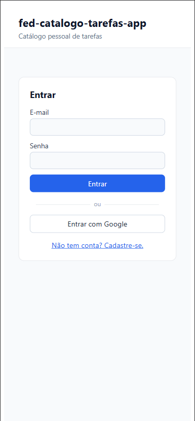
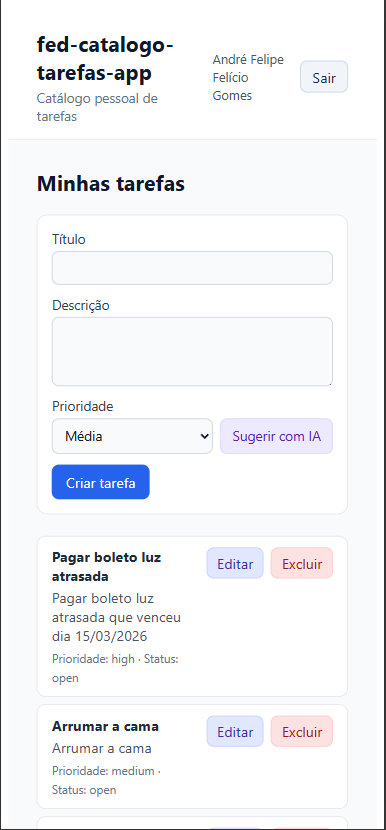
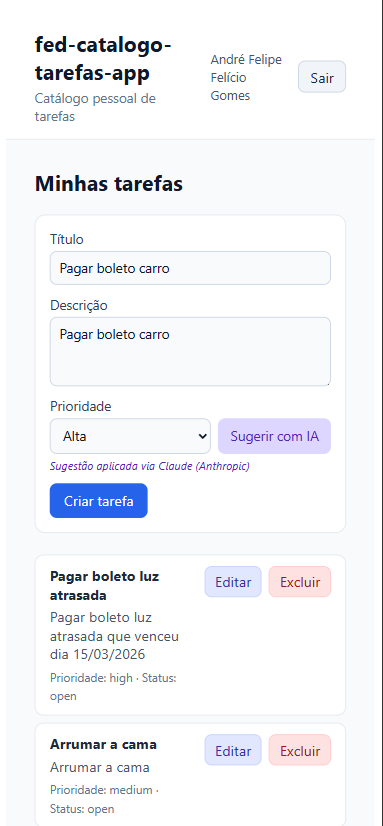
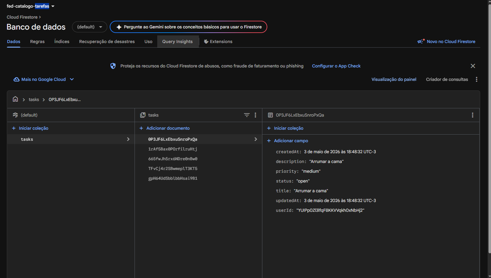
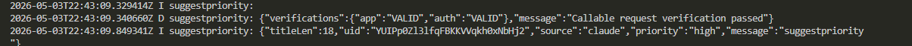

# fed-catalogo-tarefas

SPA pessoal de **gestão de tarefas** com persistência no Firebase Firestore,
construída como entrega final da disciplina de pós-graduação em IA aplicada
ao desenvolvimento de software. O destaque é uma **sugestão de prioridade
assistida por IA** via Cloud Function que chama o Claude Haiku 4.5 (Anthropic)
e cai num fallback heurístico determinístico quando a chave não está
configurada — ilustrando na prática a lição da Unidade 3.2 sobre evitar
duplicação de lógica entre IA e fallback.

## Stack

| Camada                | Tecnologia                                    |
|-----------------------|-----------------------------------------------|
| Frontend              | Angular 20 (standalone, Signals, SCSS)        |
| Persistência          | Firebase Firestore via AngularFire (`inject`) |
| Autenticação          | Firebase Auth (e-mail/senha + Google)         |
| Backend serverless    | Cloud Functions Node 20 (callable v2)         |
| IA de runtime         | Anthropic Claude Haiku 4.5 (`@anthropic-ai/sdk`) |
| Validação runtime     | zod                                           |
| Hospedagem            | Firebase Hosting                              |
| Proteção contra abuso | Firestore Rules + Firebase App Check (reCAPTCHA v3) |
| Testes                | Karma + Jasmine (unit) · Jest (functions) · Playwright + axe-core (E2E + a11y) |

## Como rodar (máquina limpa)

> ℹ️ Pré-requisitos: Node 20+, npm 10+, Firebase CLI (`npm i -g firebase-tools`).

```bash
# 1. Clone e entre no app
git clone <repo>
cd fed-catalogo-tarefas

# 2. Instale dependências do app e das functions
cd fed-catalogo-tarefas-app && npm install
cd ../functions && npm install

# 3. Rode o dev server
cd ../fed-catalogo-tarefas-app
npm start                     # ng serve em http://localhost:4200

# 4. Em outro terminal, rode os testes (opcional)
npm run test                  # unit tests Karma
npm run e2e                   # Playwright E2E + axe a11y

# 5. Logue-se com email/senha ou Google e use o app.
#    A página /login redireciona pra / depois do auth.
```

> Em desenvolvimento, o app conecta diretamente ao Firestore real do
> projeto `fed-catalogo-tarefas`. As Firestore Rules (autenticadas)
> garantem isolamento por usuário — você só vê suas próprias tarefas.

### Macro-tarefas via Makefile (ou scripts npm equivalentes)

| Comando | O que faz |
|---|---|
| `make install` | `npm install` em `fed-catalogo-tarefas-app/` e `functions/` |
| `make serve` | `ng serve` |
| `make test` | unit (Karma) + e2e (Playwright) |
| `make lint` | `ng lint` |
| `make build` | build de produção do app |
| `make rules-deploy` | publica `firestore.rules` + `firestore.indexes.json` |

> No Windows sem `make`, abra os comandos do `Makefile` direto no Git Bash.

## Documentação

- [Escopo do MVP](./docs/escopo-MVP.md) — objetivo, RFs, RNFs e fora-de-escopo
- [Backlog](./docs/backlog.md) — releases Core / Qualidade / Final
- [Arquitetura](./docs/arquitetura.mmd) — diagrama Mermaid
- [Decisões arquiteturais (DEC-001..006)](./docs/decisoes.md)
- [Gestão de riscos e comunicação](./docs/riscos/) — identificação, análise, resposta e status para stakeholders
- [Prompts usados](./docs/prompts/) — registro de cada prompt enviado a IA

## Roadmap (releases)

- **Release 1 — Core (v0.1.0)** ✅ — CRUD básico de tarefas em Signals + zod, Playwright smoke.
- **Release 2 — Qualidade (v0.2.0)** ✅ — Auth, regras de segurança autenticadas, isolamento por usuário, testes (16 unit + E2E), Makefile.
- **Release 3 — Final (v1.0.0)** ✅ — Cloud Function `suggestPriority` com Claude + fallback heurístico, App Check (reCAPTCHA v3), deploy.

## Como a IA foi usada neste projeto

A disciplina trata de **IA aplicada ao desenvolvimento de software**, então
a IA aparece em **dois lugares distintos** no projeto — fronteiras claras,
papéis diferentes:

### 1. IA como parceira de desenvolvimento

A construção inteira do código foi conduzida com **Claude Code** (modelo
Claude Opus 4.7 com 1M de contexto), em conversa interativa com o autor.
**Nada foi gerado em batch sem revisão** — a IA propõe, o autor revisa,
aprova ou redireciona. Cada prompt fica registrado em
[`docs/prompts/`](./docs/prompts/):

- [P-001 — Bootstrap completo da Release 1](./docs/prompts/01-bootstrap.md)
- [P-002 — Release 2: Qualidade](./docs/prompts/02-release-2-quality.md)
- [P-003 — Release 3: Final (Claude + App Check + deploy)](./docs/prompts/03-release-3-final.md)

**Práticas explicitamente seguidas pela IA durante o desenvolvimento:**

- **Confirmação antes de gravar arquivos sensíveis.** Ex.: `firebase.json`,
  `firestore.rules` e `firebase-config.ts` foram apresentados como rascunho
  no chat, com explicação, antes de ir para o disco. Isso reproduz a
  prática da **Unidade 4.2** ("não fazer suposições silenciosas").
- **Alertas explícitos de risco de duplicação.** Quando, na Release 1, a
  IA percebeu que tinha escrito `tasksSignal` em dois lugares no
  `TaskService`, ela parou e avisou — antes de eu pedir review. Foi a
  primeira aplicação prática da **Unidade 3.2** (caso PriorityAdvisor).
- **Decisões registradas com motivo, alternativas e consequências.** Veja
  `docs/decisoes.md` — toda escolha "por que zod e não io-ts", "por que
  Signals e não NgRx", "por que apiKey no Git", "por que Claude e não
  OpenAI" tem ADR-lite com rationale.

### 2. IA dentro do produto (runtime)

A função `suggestPriority` é onde a IA aparece **em runtime, no produto,
sendo útil para o usuário final**. Fluxo:

```
[usuário escreve título e descrição da tarefa]
            ↓
[clica "Sugerir com IA" no formulário]
            ↓
[Cloud Function callable suggestpriority]
            ↓
   ┌────────┴────────┐
   ↓                 ↓
Claude           Heurística
Haiku 4.5      (fallback)
   ↓                 ↓
   └────────┬────────┘
            ↓
[priority + source devolvidos pro cliente]
            ↓
[select de prioridade preenchido + selo "via Claude" ou "via heurística"]
```

A interface do servidor é **uma só** (`suggestPriority(input, options)`), e
a decisão entre Claude e heurística acontece em **um único `if`** dentro
da função — exatamente o que a Unidade 3.2 ensina sobre **não duplicar
lógica entre IA e fallback**. Veja
[`functions/src/suggest-priority/index.ts`](./functions/src/suggest-priority/index.ts).

O cliente exibe **honestamente** a fonte da sugestão para o usuário
("Sugestão aplicada via Claude (Anthropic)" ou "via fallback heurístico").
Sem fingir que sempre é IA.

### Métricas do projeto

| Métrica                                                  | Valor       |
|----------------------------------------------------------|-------------|
| Releases entregues                                        | 3           |
| Commits Conventional                                      | ~38         |
| Prompts registrados (P-001..P-003)                        | 3           |
| Decisões arquiteturais documentadas                       | 6           |
| Modelo de IA de desenvolvimento                          | Claude Opus 4.7 (1M) |
| Modelo de IA de runtime                                  | Claude Haiku 4.5 |
| Custo médio por sugestão runtime                         | ~US$ 0,0001 |

### Lighthouse (entrega final)

Auditoria executada em guia anônima do Chrome contra
`https://fed-catalogo-tarefas.web.app/`, modo Mobile, throttling Slow 4G,
Simulated throttling. Auditoria única (não múltiplas rodadas).

| Categoria         | Score | Observação |
|-------------------|-------|------------|
| **Performance**   | 53    | ⚠️ Lighthouse reportou *"page loaded too slowly to finish within the time limit; results may be incomplete"*. Score parcial — o número real está entre 53 e o que sairia de uma medição completa. |
| **Accessibility** | 100   | ✅ supera com folga o alvo do RNF-005 (≥ 90). |
| **Best Practices**| 100   |            |
| **SEO**           | 82    | Não é critério de aceite. |

> **RNF-004 (TTI < 3s em 3G) — não cumprido nesta entrega.** O bundle
> inicial de ~638 kb (limite default do Angular CLI: 500 kb, warning
> emitido no build) domina o tempo até interatividade em conexões
> móveis. As otimizações naturais ficam como continuidade do projeto:
> `loadChildren` agressivo nas rotas, lazy-load do AngularFire em vez
> de import top-level no `app.config.ts`, `defer` blocks no template
> da página de tarefas, e provavelmente troca da estratégia de
> Firestore real-time por `getDocs` na primeira carga (com Signal
> reativo só no `onSnapshot` subsequente).
>
> A não-otimização de performance foi uma decisão consciente: o foco
> da disciplina é **IA aplicada ao desenvolvimento**, não engenharia
> de performance web. Reconhecer a limitação é mais didático do que
> mascará-la.

### Reflexões da disciplina

**Lição da Unidade 3.2 (caso PriorityAdvisor) — duplicação de lógica.**
O perigo é duplicar a *classificação de prioridade* entre IA e fallback;
não é duplicar o *contrato* zod entre cliente e servidor. A primeira
duplicação fragmenta a evolução; a segunda é normal em fronteiras de
processo. Ver DEC-005.

**Lição da Unidade 4.2 — não fazer suposições silenciosas.** Cada arquivo
sensível (`firebase.json`, `firestore.rules`, `firebase-config.ts`) foi
apresentado para revisão antes de ir ao disco. Cada decisão arquitetural
foi alinhada antes de codar (8 perguntas no início da Release 2; 7 na
Release 3). O atrito inicial paga em segurança e auditabilidade.

**Lição extra: a IA pergunta, mas você decide.** A pergunta "para que
vamos usar a OpenAI mesmo?", durante o início da Release 3, não foi
resistência — foi uma chance de a IA explicar o **propósito** do recurso,
e em troca o usuário pediu **Claude em vez de OpenAI**. Decisões boas
saem de pausas curtas, não de execuções rápidas.

### Evidências da entrega

**1. Tela de login com email/senha + Google**



**2. Página de tarefas com lista**



**3. Form de criação com sugestão aplicada via Claude**



**4. Console Firebase mostrando documentos em `/tasks`**



**5. Logs da Cloud Function `suggestpriority`**



> O log mostra `"verifications":{"app":"VALID","auth":"VALID"}` — confirmando
> que App Check (Fase A) está anexando token reCAPTCHA v3 às chamadas — e
> `"source":"claude","priority":"high"` — confirmando que a Cloud Function
> está chamando o Claude Haiku 4.5 e devolvendo a prioridade sugerida.


## Segurança

A `apiKey` do Firebase Web em
[`firebase-config.ts`](./fed-catalogo-tarefas-app/src/environments/firebase-config.ts)
**é pública por design** — o SDK precisa dela em runtime no navegador, então
ela aparece no JS de qualquer visitante do app independente de estar no Git
ou em variáveis de ambiente. A doc oficial confirma:
[Are Firebase API keys safe to expose?](https://firebase.google.com/docs/projects/api-keys)

A segurança real do app é construída em **5 camadas**, todas vivas e
deployadas em produção — veja [DEC-004](./docs/decisoes.md) e
[DEC-006](./docs/decisoes.md) para o raciocínio completo:

1. **Restrição HTTP referrer** na apiKey (limita QUEM pode usá-la).
2. **Firebase Auth** (login obrigatório).
3. **Firestore Security Rules autenticadas** com isolamento por `userId`.
4. **App Check com reCAPTCHA v3** (garante que vem do SEU app).
5. **Cloud Function** valida `request.auth` e `App Check` antes de chamar Claude.

A **chave da Anthropic**, ao contrário da apiKey Firebase, **é segredo
real**. Ela vive no Google Secret Manager, exposta à Cloud Function via
`defineSecret('ANTHROPIC_API_KEY')`. Configuração:

```bash
firebase functions:secrets:set ANTHROPIC_API_KEY
# cole a chave quando solicitado
```

### Checklist de deploy

Em ordem, antes de cada novo deploy de produção:

- [ ] **1. Restringir a `apiKey` por HTTP referrer** no Google Cloud
  Console → Credentials → "Browser key" → HTTP referrers:
  - `http://localhost/*`, `http://127.0.0.1/*`,
    `https://fed-catalogo-tarefas.web.app/*`,
    `https://fed-catalogo-tarefas.firebaseapp.com/*`
- [ ] **2. Habilitar provedores de Auth** em
  https://console.firebase.google.com/project/fed-catalogo-tarefas/authentication/providers
  (Email/Password e Google).
- [ ] **3. Configurar a chave Anthropic** como segredo:
  `firebase functions:secrets:set ANTHROPIC_API_KEY`.
- [ ] **4. Registrar reCAPTCHA v3** em
  https://console.firebase.google.com/project/fed-catalogo-tarefas/appcheck
  e colar a *site key* em `firebase-config.ts` → `recaptchaSiteKey`.
- [ ] **5. Publicar rules + indexes**:
  `firebase deploy --only firestore:rules,firestore:indexes`.
- [ ] **6. Deploy da app + functions**: `firebase deploy`.
- [ ] **7. Aguardar 24-48h** monitorando App Check Métricas, depois
  **ligar enforcement** em Authentication, Firestore e Functions no
  console (Fase B do DEC-006).
- [ ] **8. Configurar alertas de orçamento** em
  https://console.cloud.google.com/billing/budgets?project=fed-catalogo-tarefas
  (recomendação: US$ 5/mês para o plano Blaze).

### O que NÃO funcionaria como segurança

- ❌ Esconder a `apiKey` Firebase em `.env.local` — ela acaba no bundle.
- ❌ Ofuscar/minificar o JavaScript — DevTools mostra tudo.
- ❌ Rotacionar a chave Firebase — não há mecanismo automático.
- ❌ Confiar **só** em Auth ou **só** em rules — defesa em profundidade.

## Licença

Projeto acadêmico — uso pessoal e educacional.
